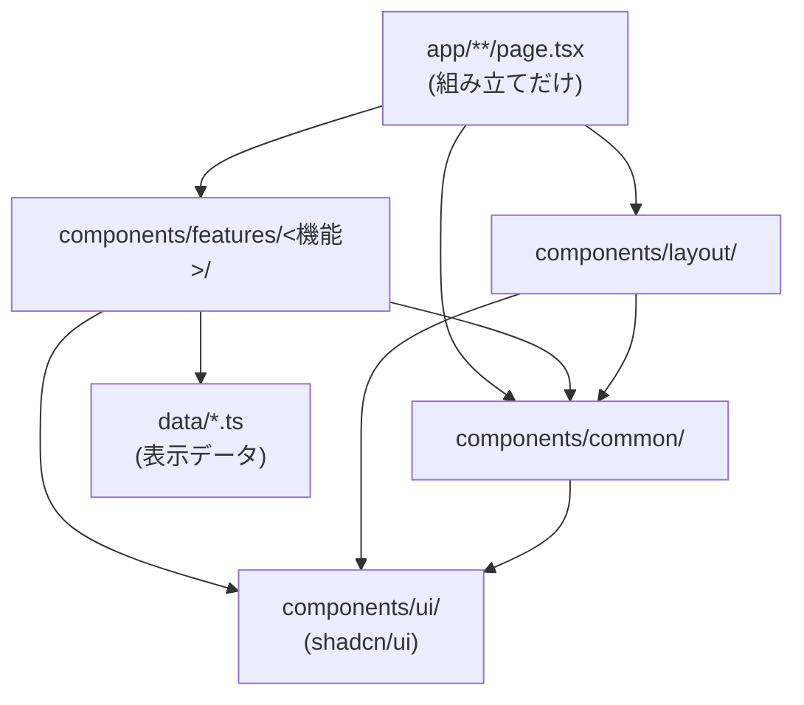

# コンポーネントの構成

決定の経緯は [ADR 0005](../adr/0005-component-architecture.md)、見た目の約束事は [theme.md](theme.md)。
新しい部品を作ったら、この一覧に足す。

## 層と依存の向き



- 矢印の向きにだけ import してよい。逆向き (ui → common など) や features 同士の import はしない
- ページは `TabPageTemplate` (タブ付きのページ) か `PageTemplate` (見出しがタブ名でないページ) で包み、中身は features / common の部品を並べるだけにする
- タブ付きのページはルートグループ `app/(tabs)/` に置き、共通のレイアウト (`SiteFrame`) がタブバーと本文の入れ物を持つ。サイト内の移動ではタブバーを描き直さない (ADR 0035)。読み込み中の枠を区画ごとに出す `loading.tsx` は置かない (ADR 0036)。本文は Cookie の `<Suspense>` の外に置き、既定の言語で殻に出す (ADR 0038)
- 表示する文言・数値は `data/` に置く。部品はデータを props か `data/` から受け取る
- 文言は言語ごとに持つ (ADR 0026)。固定の文言は `data/messages/`、表示データの英語版は `data/en/` で、言語ごとの入口は `data/localized.ts`。Client Component は `useLocale()` / `useMessages()`、Server Component は `getLocale()` / `getMessages()` で今の言語を読む

## 一覧

### ui (`components/ui/`): 基本部品 (shadcn/ui)

| 部品 | 役割 |
| --- | --- |
| `Button` | ボタン。variant: default / outline / secondary / ghost / link / destructive |
| `Badge` | 小さなラベル。variant: status (継続中) / secondary (参画先) / muted (使用技術) |
| `Card` | カードの面 |
| `Dialog` | モーダル。閉じるボタンの名前は「閉じる」。`overlayClassName` で背景の暗幕の濃さを変えられる |
| `Tabs` | タブ切り替え (矢印キーで移動できる) |
| `Input` | 入力欄 |
| `Textarea` | 複数行の入力欄。Input と同じ見た目 |

### common (`components/common/`): 画面をまたいで使う部品

`import { Section, GlassPanel } from "@/components/common"` のように index から import する。
例外は `Markdown`。`@/components/common/markdown` から直接 import する。barrel で再 export すると、
Markdown を使わないページ (/skills・/works の一覧) の最初の読み込みにも react-markdown が入るため (PBI-010)。

| 部品 | 役割 |
| --- | --- |
| `GlassPanel` | ガラス調の面 (`glass-panel`)。padding: md / lg |
| `Section` | h2 の見出し付きの区切り。size: md / lg |
| `Callout` | 一段目立たせる囲み。variant: emphasis (左に線) / tinted (薄い色) |
| `BulletList` | 黒丸の箇条書き |
| `TagList` | バッジを横に並べた一覧。`label` で何の一覧かを読み上げる |
| `TextLink` | 本文中のリンク。外部 URL は新しいタブで開き `rel="noopener noreferrer"` を付ける |
| `Markdown` | Markdown の本文。GFM と ```` ```mermaid ```` の図に対応。見出しは h3 から |
| `MermaidDiagram` | Markdown の中の ```` ```mermaid ```` を図にする。mermaid は図があるときだけ読み込む |

### layout (`components/layout/`): 全ページ共通の枠

| 部品 | 役割 |
| --- | --- |
| `SiteFrame` | タブ付きのページの共通の枠。共通のレイアウト (`app/(tabs)/layout.tsx`) が使う。タブバー・アドレスバーは `<Suspense>` の中で言語を読んで配り、本文の入れ物はその外に置く。サイト内の移動ではタブバーを描き直さない (ADR 0035、0038) |
| `Localized` | 既定の言語で描いた木を `<Suspense>` の fallback にし、Cookie の言語で同じ木を描き直す。タブ付きのページが本文を殻に置くために使う (ADR 0038) |
| `TabPageTemplate` | タブ付きのページの h1 (タブ名) + 本文パネル。見出しと本文は殻に置き、パネルの中ではもう待たない (ADR 0036、0038) |
| `PageTemplate` | h1 + 本文パネル。見出しがタブ名でないページ (/now の記事、404) が使う。タブバーと外枠は `SiteFrame` が持つ |
| `PanelFrameFallback` | 本文のパネルが届くまでの枠 (見出しの場所 + パネル)。言語の文言を使わない殻 |
| `PanelBodyFallback` | パネルの中身が届くまでの線 (`aria-busy`)。本文が殻に無いときの枠 (`PanelFrameFallback`) が使う |
| `BrowserTabs` | ブラウザ風のタブ (`nav`「ページ切り替え」、現在地に `aria-current="page"`) とアドレスバー。タブの中身は `lib/navigation.ts` |
| `LocaleSwitch` | 右上 (アドレスバーの右端) の EN / JP スイッチ (`group`「表示言語」、選択中に `aria-pressed`)。Cookie に言語を残す (ADR 0026) |
| `RssButton` | RSS フィードへのリンク |
| `ThemeProvider` | next-themes。既定はダーク |

### features (`components/features/<機能>/`): ページ・機能ごとの部品

| 機能 | 部品 | データ |
| --- | --- | --- |
| career | `CareerTimeline`, `EngagementsDialog` | `data/career.ts` |
| skills | `SkillsVisualization`, `SkillRadar` | `data/skills.ts` |
| works | `WorkGallery`, `WorkCard`, `WorkDetailDialog` | `data/works.ts` |
| chat | `ResumeChat`, `ChatBubble`, `SuggestionList` | — (API から) |
| contact | `ContactForm` | `data/messages/` の `contact`、`POST /api/contact` |
| background | `BackgroundScene`, `Scene`, `themes/*` (テーマごとのシーン) | `lib/background-theme.ts` (選択中のテーマ)、`lib/theme.ts` の色 (グリッドのみ) |
| theme | `ThemePicker` | `lib/background-theme.ts` |
| now | `NowPostList`, `NowPostCard`, `NowPostDialog` | `lib/now/store.ts` (POST /api/now で投稿した記事)、`data/now.ts` (拠点・受付状況) |

## 部品を作るときの約束

- **押せるものは `button` か `a`**。`div` に `onClick` を付けない (キーボードで操作できず、E2E でもロールで取れない)
- **要素にはロールと名前が付くようにする**。E2E は `getByRole` で取るので、名前のない領域には `aria-label` を付ける (例: 会話のログ、参画先の一覧)
- 見た目の種類は props (`variant` `size`) で表し、呼び出し側で長いクラスを組み立てさせない
- 色はトークンだけを使う ([theme.md](theme.md))
- ブラウザでしか描けないものは `useIsClient()` (`hooks/use-is-client.ts`) で出し分ける。`useEffect` で `setState` しない (lint で落ちる)
- コメントは日本語で、理由 (なぜそうするか) を書く
